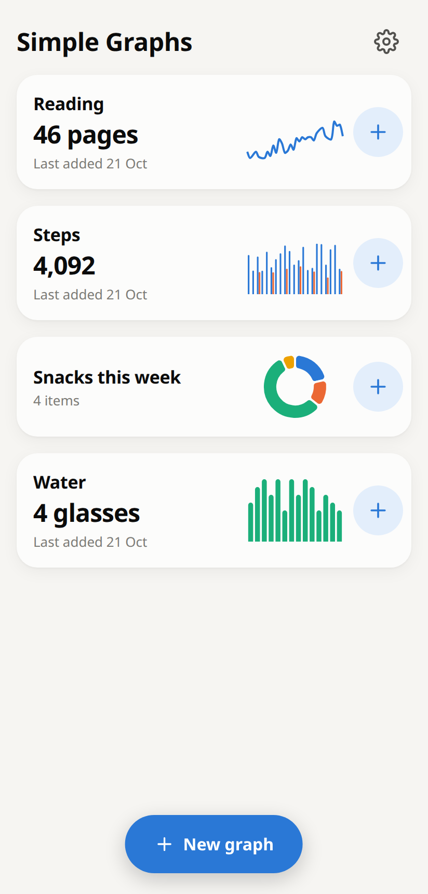
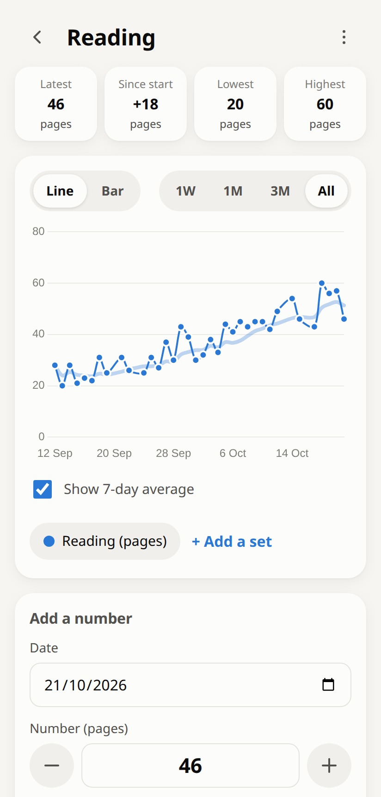
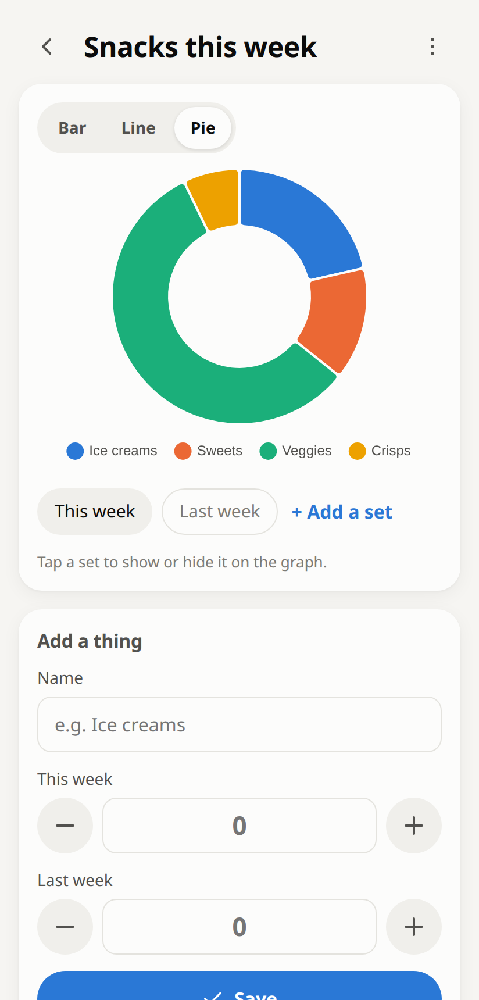

# Simple Graphs

**Turn your own numbers into clean, simple graphs, right on your phone.**

Track something every day, or compare a few things side by side. Everything stays on your phone: no account, no sign-up, nothing uploaded.

**👉 Open the app: https://aitoniai.github.io/simple-graphs/**

<p align="center">
  
  
  
</p>

## What it does

- 📅 **Track over time.** Add a number for today, or any past day, and see it as a line or bar graph.
- 🍦 **Compare things.** Ice creams 3, Sweets 2, Veggies 8 → a bar chart or a pie chart.
- ➕ **Several sets on one graph.** Put "Walk" and "Run", or "This week" and "Last week", on the same graph.
- 📈 **Helpful extras.** Latest, lowest and highest at a glance, a 7-day average line, and 1 week / 1 month / 3 months / all views.
- 🌙 **Light and dark mode.** It follows your phone automatically.
- ✈️ **Works offline.** Once installed, it opens like any other app, even without internet.
- 🔒 **Private.** Your numbers are saved only on your phone.

## Install it on your phone (1 minute)

1. Open **https://aitoniai.github.io/simple-graphs/** in **Chrome**.
2. Tap the **⋮** menu (top right) → **Add to Home screen** → **Install**.
3. The **Simple Graphs** icon appears on your home screen. Open it from there from now on.

> On an iPhone, open the link in Safari and use **Share → Add to Home Screen**.

## How to use it

The **[user guide](docs/guide.md)** walks through everything with pictures. The short version:

| | |
|---|---|
| **Make a graph** | Tap **New graph**, give it a name, and choose **Dates** (tracking over time) or **Things** (comparing items). |
| **Add a number** | Tap the **+** next to a graph on the home screen, check the date, then tap **Save**. |
| **Change the graph type** | Tap **Line**, **Bar** or **Pie** above the graph. |
| **Two sets on one graph** | Tap **+ Add a set**, then tap the set buttons to show or hide each one. |
| **Fix a mistake** | Scroll to **Your numbers**, tap a number to change it, or tap 🗑 to delete it (with Undo). |
| **Keep a backup** | ⚙ Settings → **Back up**. |

---

## For developers

Built with [Svelte 5](https://svelte.dev), [Vite](https://vite.dev) and [Chart.js](https://www.chartjs.org). Data is stored in IndexedDB via [idb-keyval](https://github.com/jakearchibald/idb-keyval), and [vite-plugin-pwa](https://vite-pwa-org.netlify.app) makes it installable and offline-capable.

```sh
npm install
npm run dev -- --host   # then open http://<your-ip>:5173/simple-graphs/ on a phone on the same Wi-Fi
npm test                # unit tests (Vitest)
npm run build           # production build in dist/
```

| Path | What's there |
|---|---|
| `src/views/` | Screens: Home, NewGraph, Graph, Settings |
| `src/lib/graphs.js` | Data model helpers (pure, unit-tested) |
| `src/lib/chartType.js` | Which chart types fit the data (e.g. when pie is allowed) |
| `src/lib/Chart.svelte` | Chart.js wrapper that follows the light/dark theme |
| `src/lib/db.js` | IndexedDB storage and backup files |
| `scripts/make-icons.js` | Regenerates the PNG app icons |

**Deploying:** every push to `main` runs the tests, builds, and publishes to GitHub Pages (`.github/workflows/deploy.yml`). Repo **Settings → Pages → Source** must be set to **GitHub Actions**. The repo name has to match `base` in `vite.config.js` (`/simple-graphs/`).
