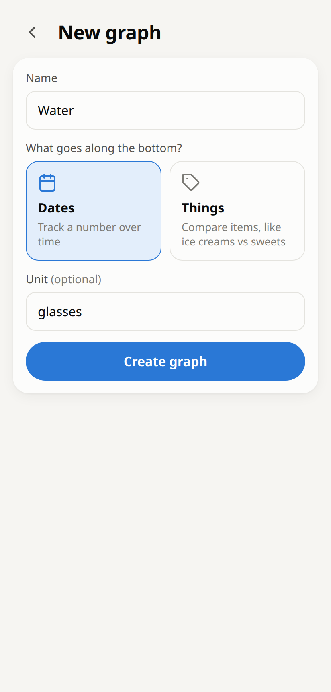
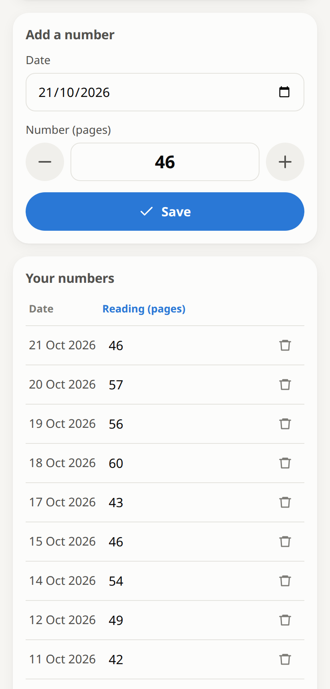
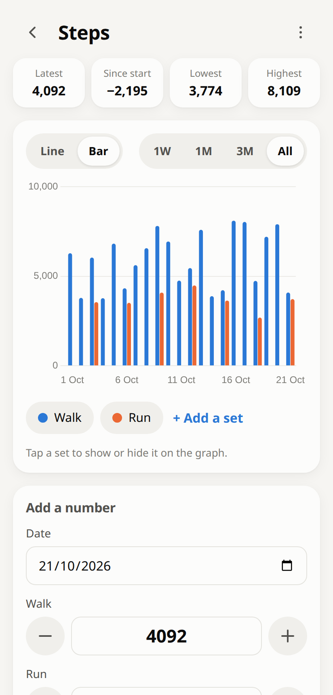
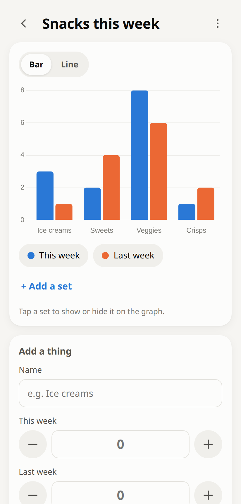
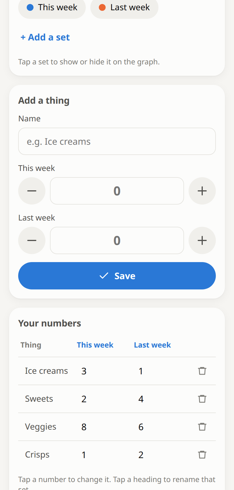
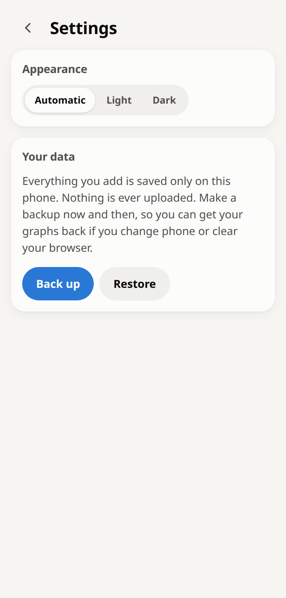
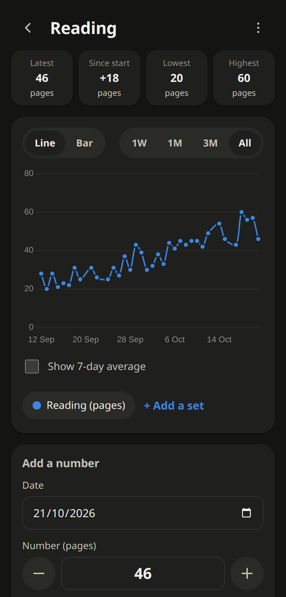

# Simple Graphs: user guide

A step-by-step guide with examples. If you haven't installed the app yet, see [Install it on your phone](../README.md#install-it-on-your-phone-1-minute).

- [1. The home screen](#1-the-home-screen)
- [2. Make a graph](#2-make-a-graph)
- [3. Example: track something every day](#3-example-track-something-every-day)
- [4. Example: compare things](#4-example-compare-things)
- [5. Example: two sets on one graph](#5-example-two-sets-on-one-graph)
- [6. Change or delete numbers](#6-change-or-delete-numbers)
- [7. Rename or delete a graph](#7-rename-or-delete-a-graph)
- [8. Backups and settings](#8-backups-and-settings)
- [Questions](#questions)

---

## 1. The home screen

All your graphs are listed here. Each card shows:

- the graph's **name**
- the **latest number** (for date graphs)
- a **small preview** of the graph

Tap a card to open the graph.
Tap the **+** on the right to jump straight to adding a number. This is the quickest way to log something every day.

Tap **New graph** at the bottom to make a new one, and **⚙** at the top for settings.

 

---

## 2. Make a graph

1. Tap **New graph**.
2. Give it a **name**, e.g. *Water*.
3. Choose what goes **along the bottom** of the graph:
   - **Dates** if you're tracking a number over time (steps, water, pages read, hours slept…).
   - **Things** if you're comparing items (snacks, chores, money spent on groceries vs. bills vs. fun…).
4. Optionally add a **unit**, e.g. *glasses*, *kg*, *£* or *steps*. It's shown next to your numbers.
5. Tap **Create graph**.

The app opens your new graph, ready for the first number.

 

---

## 3. Example: track something every day

*Example: pages read each day.*

**Adding today's number**

1. On the home screen, tap the **+** next to the graph.
2. The **date** is already set to today.
3. Type your number, or use **−** and **+** to adjust it. The box starts at your last number, so small changes are quick.
4. Tap **Save**.

**Forgot a day?** Tap the date and pick the day you missed, then save. The graph puts it in the right place automatically.

**Saved twice on the same day?** No problem: the newer number replaces the older one for that day.

 

**Reading the graph**

- The four boxes at the top show your **latest** number, the change **since you started**, and the **lowest** and **highest**.
- **Line / Bar** switches the style of graph.
- **1W / 1M / 3M / All** shows the last week, month, three months, or everything.
- **Show 7-day average** adds a soft, smooth line that ignores day-to-day ups and downs, so you can see the overall trend.
- **Tap anywhere on the graph** to see the exact number and date.

 

---

## 4. Example: compare things

*Example: snacks eaten this week.*

1. Make a new graph called *Snacks this week* and choose **Things**.
2. In **Add a thing**, type *Ice creams*, enter **3**, and tap **Save**.
3. Do the same for *Sweets* **2**, *Veggies* **8** and *Crisps* **1**.

Your bar chart is ready. Tap **Pie** to see it as a pie chart instead. Tap a slice to see its number and its percentage of the total.

> **Why can't I see "Pie"?** A pie chart only makes sense when there's **one set** of numbers on the graph, all of them **above zero**, and **no more than 8** things. If you're showing two sets, hide one (see the next example) and Pie appears.

**Changing a number:** to update *Ice creams*, either change it in the table (see [section 6](#6-change-or-delete-numbers)) or add *Ice creams* again with the new number. It replaces the old one rather than making a duplicate.

 

---

## 5. Example: two sets on one graph

A **set** is a list of numbers. Every graph starts with one, and you can add more to show several together.

**Example: walking and running steps**

1. Open your *Steps* graph and tap **+ Add a set**.
2. Name it *Run* and tap **Save**. (You can rename the first set to *Walk*: tap its name in the **Your numbers** table.)
3. Now when you add a number, there's a box for **Walk** and a box for **Run**. Leave a box empty if you didn't do it that day.

Each set has its own colour. The buttons under the graph act as the key, and you can **tap them to show or hide** that set.

 

**Example: this week vs. last week**

On the *Snacks* graph, add a set called *Last week*. Fill in its numbers in the table or when adding a thing, then tap **Bar**. The two weeks appear side by side for each snack.

 

---

## 6. Change or delete numbers

Scroll down to **Your numbers**.

- **Change a number:** tap it, type the new number, then tap elsewhere. The graph updates straight away.
- **Rename a thing:** on *Things* graphs, tap the name in the first column and edit it.
- **Delete a row:** tap the 🗑 bin. Deleted by mistake? Tap **Undo** in the message at the bottom of the screen.
- **Rename a set, change its unit, or delete it:** tap the blue heading at the top of its column.

Date graphs show the newest 10 rows first. Tap **Show all** to see everything.

 

---

## 7. Rename or delete a graph

Open the graph and tap **⋮** (top right).

- Change the name and tap **Save**, or
- tap **Delete graph**. This removes the graph and all its numbers, and it can't be undone, so make a backup first if you're unsure.

---

## 8. Backups and settings

Tap **⚙** on the home screen.

**Appearance:** **Automatic** follows your phone's light/dark setting. Or pick **Light** or **Dark**.

**Back up:** saves all your graphs into one small file in your phone's **Downloads** folder (named like `simple-graphs-backup-2026-10-21.json`). Do this every now and then.

**Restore:** pick a backup file to bring your graphs back, for example on a new phone. This **replaces** what's currently in the app, so you'll be asked to confirm first.

 

---

## Questions

**Where are my numbers stored?**
Only on your phone, inside the app. Nothing is sent to the internet, and nobody else can see them, not even the person who made the app.

**Does it need internet?**
Only the first time you open it. After it's installed, it works offline.

**Could I lose my numbers?**
They're safe through normal use, app updates and restarts. They **would** be lost if you uninstall the app, clear Chrome's data for this site, or change phone. That's what **Back up** is for.

**Can I use it on two phones?**
Each phone keeps its own copy. Use **Back up** on one phone and **Restore** on the other to copy everything across.

**How do I get updates?**
Automatically. When a new version is published, the app updates itself the next time you open it with internet.

**Can I use decimals?**
Yes, e.g. *7.5*. The **−**/**+** buttons step by 0.1 once a set contains decimals, and by 1 otherwise.

 
